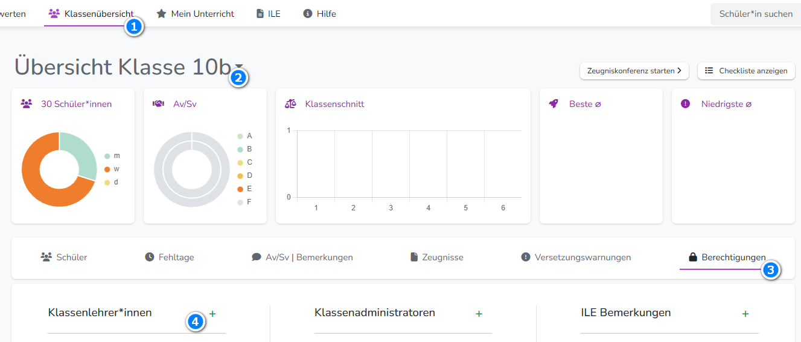
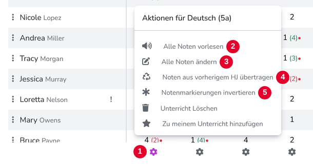
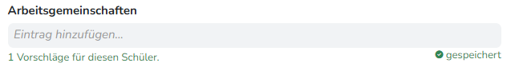
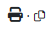

<!-- base-font-size: 80% -->
<!-- numbering -->

<!-- center -->
<!-- font-size: 200% -->
**Anleitung Diplomify**
<!-- /font-size -->

Version {date}   
<!-- font-size: 80% -->
<!-- width: 75% -->
Hinweis: Aus Gründen der besseren Lesbarkeit wird im Folgenden auf die gleichzeitige Verwendung der Sprachformen männlich, weiblich und divers (m/w/d) verzichtet.
<!-- /width -->
<!-- /center -->

---

## erster Überblick

<!-- width: 45% -->

* Menüband oben
  (1) Bewerten: für Klassenlehrer: Kontrolle über eingetragene Noten; Übernahme epochaler Fächer
  (2) Klassenübersicht: Einstiegspunkt für Klassenlehrer für Vorbereitungen
  (3) Mein Unterricht: Alles für Fachlehrer: Noten, AV/SV, Bemerkungen

* 💡 Klassenlehrer beginnen in (2), alle anderen in (3) 

---

## FAQ

<!-- width: 75% -->

* im Aufbau...

* gibt es eine Dokumentation des Tools? Ja, sehr ausführlich, erreichbar über die Schaltfläche im oberen Band rechts
  * in der Dokumentation links oben ins Suchfeld tippen...

* weiteres folgt...

---

## Vorbereitung [Klassenlehrer]
1. Eintragen der Klassenleitungen *[leider nicht per Import möglich]*
`Klassenübersicht > Klasse auswählen > Reiter "Berechtigungen"`
  * Klick auf das grüne + hinter Klassenlehrer\*innen

<!-- width: 80% -->

---

2. Setzen der Zeugnisvorlage *[leider nicht automatisiert möglich]*
`Klassenübersicht > Klasse auswählen > Reiter "Zeugnisse"`
  * ein Klick auf Kopf „Standard“  

3. Anzeigen der Checkliste
`Klassenübersicht > Klasse auswählen > Checkliste anzeigen (oben rechts)`
  * Offensichtlich ist noch einiges zu tun... ;-)

---

4. [nur b-Klassen] Kontrolle Musikzweig
`Klassenübersicht > Reiter "Schüler"`
  * ersten Schüler anklicken, Kontrolle der Tags
<!-- width: 75% -->

  * für Musikzweig muss das erste Icon vorhanden sein: zum Setzen auf das rechte Notensymbol, zum Entfernen des Schülers auf das linke Notensymbol klicken

---

## Noteneingabe [Fachlehrer]

`Mein Unterricht > bewerten`

<!-- width: 15% -->

> „Was im Notenfeld steht, landet auch auf dem Zeugnis.“
* ❗ **keine Anhängsel + oder - eintragen**
* 💡 mit Tab schneller Wechsel zur Eingabe des nächsten Schülers
* 💡 Automatisches Speichern der Notentabelle.

---

### Notensprünge

`Mein Unterricht > bewerten`

* Begründung Notensprünge
  Abb
  * negativer Notensprung erkennbar an rot dargestellter Vornote
  * roter Indikator gibt Notwendigkeit zur Begründung an
  > „fehlt die Begründung für den Notensprung, wird der rote Punkt angezeigt. [...] Ist eine Begründung vorhanden, wird die Vornote weiterhin farbig angezeigt, der rote Indikator wird aber ausgeblendet.“

---

## Wahlunterricht / Sprachfeststellungsprüfung [Fachlehrer]

* **todo** in klv eigene Felder

---

## Epochale Fächer (nur 2. Halbjahr) [Klassenlehrer]

`Bewerten > Klasse > Zahnrad unter jeder Notenspalte`
* Punkt 4: „Noten aus vorherigem HJ übertragen“
<!-- width: 50% -->

---

## Eintragen der Fehltage [Klassenlehrer]

* keine Eingabe notwendig, wird kurz vor Zeugniserstellung automatisch aus WebUntis importiert.
* ❗ keine eigenen Eintragungen vornehmen, der Import überschreibt diese.

---

## Versetzungswarnungen [Klassenlehrer]

* **todo**

---

## Bemerkungen, AGs und AV- und SV-Einträge [Fachlehrer]

### Eintragen von AV/SV

`Mein Unterricht > bewerten > Abschnitt Arbeits- & Sozialverhalten (AV/SV)`
* Haken bei "Untätig der Klassenleitung zustimmen." rausnehmen; Bewertung setzen; ggf. Begründung einfügen  

### Eintragen von AGs
`Mein Unterricht > bewerten > Abschnitt Individuelle Vorschläge`
* Klick auf Vorschlag > Vorschläge > entsprechende AG mit + wählen

* ❗ Erst die Schaltfläche „abschicken“ speichert den Vorschlag. Ohne sie sieht die Klassenleitung nichts.

---

## Bemerkungen, AGs und endgültige Einträge zum AV/SV [Klassenlehrer]

### Prüfen und Eintragen AV/SV
`Klassenübersicht > Reiter "Av/Sv | Bemerkungen"`
<!-- width: 35% -->

* Vorbelegung für alle Schüler ist `F`; hier erscheint *kein* Eintrag im Zeugnis
* über Kopf AV bzw. SV links „alle ausfüllen: C“ zunächst alle Schüler mit C belegen
* für Anpassungen bei Abweichungen von `C`: Regler rechts entsprechend setzen, Einschätzung des Klassenkollegiums ist über Anzahlen oberhalb des Reglers erkennbar; für `D` und `E` Text ins Feld Bemerkungen eintragen, dabei das Symbol `</>` für Wahl des Vornamens bzw. Platzhalter `/vorname` verwenden.

---

### Bemerkungen, AGs: Übernehmen von Vorschlägen

`Klassenübersicht > Reiter "Av/Sv | Bemerkungen"`
<!-- width: 75% -->

* Klick auf *Eintrag hinzufügen...*
* dann über „alle Vorschläge hinzufügen“ oder + übernehmen

---

## DAZ-Schüler [Klassenlehrer]

* todo

---

## Abgangszeugnisse [Klassenlehrer]

* todo

---

## Abschlusskontrolle [Klassenlehrer]

* Checkliste prüfen (s.o.)
`Klassenübersicht > Klasse auswählen > Checkliste anzeigen (oben rechts)`  
* Zeugnisvorschau
  * Einzelzeugnisse über `Klassenübersicht > Schüler > Symbol rechts neben Schüler`
  * ❗ nur möglich, wenn eine Zeugnisvorlage in der Vorbereitung gewählt wurde)
<!-- width: 5% -->

  * Zeugnisse der gesamten Klasse über `Klassenübersicht > Zeugnisse > Button "Alle Zeugnisse" unten rechts`
<!-- width: 15% -->

---

## praktische Links

[Umstieg von KLV: So arbeiten Sie in Diplomify](https://docs.diplomify.de/s/academy/doc/umstieg-von-klv-so-arbeiten-sie-in-diplomify-USYvoNaYqr)

[Wo kommt was auf dem Zeugnis her?](https://docs.diplomify.de/s/academy/doc/wo-kommt-was-auf-dem-zeugnis-her-AuLIYWTutG?q=arbeitsge)

[Umstieg von KLV: Arbeits- und Sozialverhalten](https://docs.diplomify.de/s/academy/doc/umstieg-von-klv-arbeits-und-sozialverhalten-0pVMDgZEqc)

[Umstieg von KLV: Bemerkungen](https://docs.diplomify.de/s/academy/doc/umstieg-von-klv-bemerkungen-UxB9b4Xu3o?q=bemer)