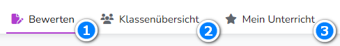
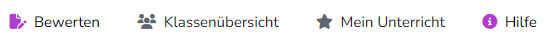
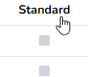
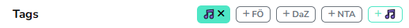
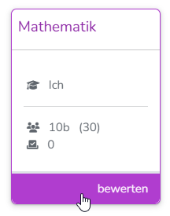
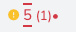

<!-- base-font-size: 80% -->
<!-- numbering -->
<!-- center -->
<!-- font-size: 120% -->
<!-- unnumbered -->
# Noteneintragung in Diplomify
<!-- /font-size -->

Version <!-- date -->26.11.2026<!-- /date -->   
<!-- font-size: 80% -->
<!-- width: 75% -->
Hinweis: Aus Gründen der besseren Lesbarkeit wird im Folgenden auf die gleichzeitige Verwendung der Sprachformen männlich, weiblich und divers (m/w/d) verzichtet.
<!-- /width -->
<!-- /center -->

---

<!-- unnumbered -->
<!-- center -->
## ❗ Willkommen zur Testphase – bitte Folgendes beachten ❗ 
<!-- /center -->

❗  Die vorliegenden Daten werden im Januar zur Noteneingabe verwendet. Also keine Fächer, Schüler etc. löschen (falls das möglich ist). Aber:
* folgt der folgenden Anleitung (Klassenlehrer / Fachlehrer)
* macht euch zu Klassenlehrern
* tragt Noten, Bemerkungen und AV/SV ein
* setzt Warnungen
* gebt Rückmeldungen, was ihr im Programm nicht findet, wo die Anleitung unklar oder fehlend ist etc.
  * das hilft mir und dem Kollegium später sicher sehr!

---

**💡 Gut zu wissen in der Testphase:**
* Noten einer Lerngruppe wieder löschen: Zahnrad in Bewertungsübersicht: „Alle Noten ändern“, Feld leer lassen, speichern
* Vorschlag AV/SV löschen: Haken bei „Untätig der Klassenleitung zustimmen.“ wieder setzen.

* Wenn alles gelöscht ist, sollte die Kachel wieder „nackt“ aussehen 
* Notenwarnungen müssen aber händisch entfernt werden

---

## erster Überblick

<!-- width: 45% -->

  * Menüband oben
    (1) Bewerten: für Klassenlehrer: Kontrolle über eingetragene Noten; Übernahme epochaler Fächer
    (2) Klassenübersicht: Einstiegspunkt für Klassenlehrer für Vorbereitungen
    (3) Mein Unterricht: Alles für Fachlehrer: Noten, AV/SV, Bemerkungen

  * 💡 Klassenlehrer beginnen bei (2), alle anderen bei (3) 

---

## FAQ

<!-- width: 75% -->

* im Aufbau...

* gibt es eine Dokumentation des Tools? Ja, sehr ausführlich, erreichbar über die Schaltfläche im oberen Band rechts
  * in der Dokumentation links oben ins Suchfeld tippen...

* weiteres folgt...

---

## Vorbereitung [Klassenlehrer]
1. Eintragen der Klassenleitungen *[leider nicht per Import möglich]*
`Klassenübersicht > Klasse auswählen > Reiter "Berechtigungen"`
  * Klick auf das grüne + hinter Klassenlehrer\*innen

<!-- width: 80% -->

---

2. Setzen der Zeugnisvorlage *[leider nicht automatisiert möglich]*
`Klassenübersicht > Klasse auswählen > Reiter "Zeugnisse"`
<!-- width: 10% -->

  * Klick auf Kopf „Standard“  

3. Anzeigen der Checkliste
`Klassenübersicht > Klasse auswählen > Checkliste anzeigen (oben rechts)`
  * Offensichtlich gibt es noch einiges zu tun... ;-)

---

4. [nur b-Klassen] Kontrolle Musikzweig
`Klassenübersicht > Reiter "Schüler"`
  * ersten Schüler anklicken, Kontrolle der Tags
<!-- width: 75% -->

  * für Musikzweig muss das linke Icon [Note x] vorhanden sein
    * zum Setzen: Klick auf das rechte Notensymbol; Enddatum löschen
    * zum Entfernen: Klick auf das linke Notensymbol

---

## Noteneingabe [Fachlehrer]

`Mein Unterricht > bewerten`

<!-- width: 55% -->

  * (1) „bewerten“ auf Kachel für Unterricht klicken
  * (2) Fortschrittsbalken
  * (3) Haken für abgeschlossene Eingabe

---

  * ❗ **keine Anhängsel + oder - eintragen**
  > „Was im Notenfeld steht, landet auch auf dem Zeugnis.“
  * Abschnitt Notenwarnung: Für 4-
  * 💡 Tab für schnellen Wechsel zum nächsten Schüler
  * 💡 Automatisches Speichern der Notentabelle.

---

### Notensprünge

`Mein Unterricht > bewerten`

<!-- width: 15% -->
  
  * in Abb. von links nach rechts: Symbol für Eingabe einer anderen als der aktuellen Fachlehrkraft; aktuelle Note, schlechter als 4; Vornote in Klammern; Indikator für Begründung des Notensprungs
  * negativer Notensprung erkennbar an rot dargestellter Vornote
  * roter Indikator gibt Notwendigkeit zur Begründung an; wird nach Eintragung der Begründung ausgeblendet

---

## Wahlunterricht / Sprachfeststellungsprüfung [Fachlehrer]

* Wahlunterricht: momentan nicht angeboten, also nichts einzutragen
* Sprachfeststellungsprüfung: *[--Umsetzung noch offen--]*

---

## Epochale Fächer (nur 2. Halbjahr) [Klassenlehrer]

`Bewerten > Klasse > Zahnrad unter jeder Notenspalte`
* Punkt 4: „Noten aus vorherigem HJ übertragen“
<!-- width: 50% -->

---

## Eintragen der Fehltage [Klassenlehrer]

* keine Eingabe notwendig, kurz vor Zeugniserstellung Import aus WebUntis
* ❗ keine eigenen Eintragungen vornehmen, der Import überschreibt diese.

---

## Versetzungswarnungen [Klassenlehrer]

* **todo, noch unklar, wohl über Floskeln**

---

## Bemerkungen, AGs und AV- und SV-Einträge [Fachlehrer]

❗ Wichtig: Alles hier eingetragene muss vom Klassenlehrer übernommen werden; er bekommt angezeigt, was die Fachlehrer aufs Zeugnis haben wollen

### Eintragen von AV/SV

`Mein Unterricht > bewerten > Abschnitt Arbeits- & Sozialverhalten (AV/SV)`
* Haken bei "Untätig der Klassenleitung zustimmen." rausnehmen; Bewertung setzen; ggf. Begründung einfügen  

### Eintragen von AGs

* erfolgt automatisch, wenn Schüler in WebUntis der AG zugeordnet ist
* Soll ein Schüler wegen häufigen Fehlens den Eintrag nicht erhalten, diesen aus dem Unterricht löschen.

<!-- font-size: 50% -->
  * [händisches Eintragen: `Mein Unterricht > bewerten > Abschnitt Individuelle Vorschläge`
<!-- font-size: 50% -->
  * Klick auf Vorschlag > Vorschläge > entsprechende AG mit + wählen]
<!-- font-size: 50% -->
  * ❗ Erst die Schaltfläche „abschicken“ speichert den Vorschlag. Ohne sie sieht die Klassenleitung nichts.

---

## Bemerkungen, AGs und endgültige Einträge zum AV/SV [Klassenlehrer]

### Prüfen und Eintragen AV/SV
`Klassenübersicht > Reiter "Av/Sv | Bemerkungen"`
<!-- width: 35% -->

  * Vorbelegung für alle Schüler ist `F`; hier erscheint *kein* Eintrag im Zeugnis
  * über Kopf AV bzw. SV links „alle ausfüllen: C“ zunächst alle Schüler mit C belegen
  * für Anpassungen bei Abweichungen von `C`: Regler rechts entsprechend setzen, Einschätzung des Klassenkollegiums ist über Anzahlen oberhalb des Reglers erkennbar; für `D` und `E` Text ins Feld Bemerkungen eintragen, dabei das Symbol `</>` für Wahl des Vornamens bzw. Platzhalter `/vorname` verwenden.

---

### Bemerkungen, AGs: Übernehmen von Vorschlägen

❗ Der Klassenlehrer bekommt angezeigt, welche Bemerkungen die Klassenkollegen vorschlagen; diese müssen übernommen werden, damit sie auf dem Zeugnis erscheinen

`Klassenübersicht > Reiter "Av/Sv | Bemerkungen"`
<!-- width: 75% -->

  * Klick auf *Eintrag hinzufügen...*
  * dann über „alle Vorschläge hinzufügen“ oder + übernehmen

---

## DAZ-Schüler [Klassenlehrer]

* todo

---

## Abgangszeugnisse [Klassenlehrer]

* todo

---

# Abschlusskontrolle [Klassenlehrer]

* Checkliste prüfen (s.o.)
`Klassenübersicht > Klasse auswählen > Checkliste anzeigen (oben rechts)`  
* Zeugnisvorschau
  * Einzelzeugnisse über `Klassenübersicht > Schüler > Symbol rechts neben Schüler`
  * ❗ nur möglich, wenn eine Zeugnisvorlage in der Vorbereitung gewählt wurde)
<!-- width: 5% -->

  * Zeugnisse der gesamten Klasse über `Klassenübersicht > Zeugnisse > Button "Alle Zeugnisse" unten rechts`
<!-- width: 15% -->

---

# Zeugniskonferenz [Klassenlehrer]

`Klassenübersicht > Klasse auswählen > Zeugniskonferenz starten > (oben rechts)`  

---

## praktische Links

[Umstieg von KLV: So arbeiten Sie in Diplomify](https://docs.diplomify.de/s/academy/doc/umstieg-von-klv-so-arbeiten-sie-in-diplomify-USYvoNaYqr)

[Wo kommt was auf dem Zeugnis her?](https://docs.diplomify.de/s/academy/doc/wo-kommt-was-auf-dem-zeugnis-her-AuLIYWTutG?q=arbeitsge)

[Umstieg von KLV: Arbeits- und Sozialverhalten](https://docs.diplomify.de/s/academy/doc/umstieg-von-klv-arbeits-und-sozialverhalten-0pVMDgZEqc)

[Umstieg von KLV: Bemerkungen](https://docs.diplomify.de/s/academy/doc/umstieg-von-klv-bemerkungen-UxB9b4Xu3o?q=bemer)